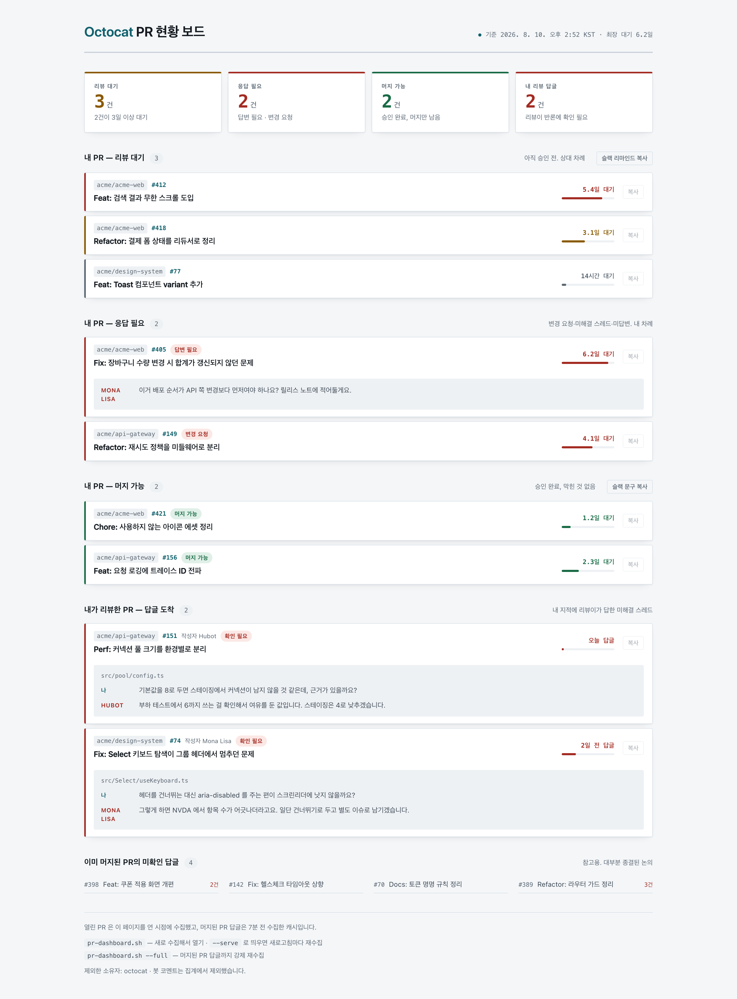

# pr-myturn

내가 올린 PR과 내가 리뷰한 PR 중 **지금 내 차례인 것**만 골라 보여주는 로컬 대시보드입니다.
GitHub 알림함은 읽은 것과 안 읽은 것으로만 나뉘지만, 실제로 알고 싶은 건 "누가 나를 기다리고 있나"입니다.

`gh` CLI 위에서 도는 셸 스크립트 네 개와 정적 HTML 하나가 전부입니다. 서버를 띄우지 않고,
데이터를 밖으로 보내지 않고, 토큰을 따로 저장하지도 않습니다.

<picture>
  <source media="(prefers-color-scheme: dark)" srcset="docs/pr-dashboard-dark.png">
  
</picture>

<sub>스크린샷은 가짜 데이터입니다. `docs/demo.html` 을 열면 같은 화면을 직접 볼 수 있습니다.</sub>

## 무엇을 보여주나

| 구획 | 기준 |
|---|---|
| 리뷰 대기 | 아직 승인 전. 상대 차례 |
| 응답 필요 | 변경 요청·미해결 스레드·미답변·충돌. 내 차례 |
| 머지 가능 | 승인 완료이고 막힌 것이 없음 |
| 리뷰 요청 | 남의 PR 중 나에게 리뷰가 요청됐고 아직 리뷰를 제출하지 않은 것. 내 차례 |
| 내 리뷰 답글 | 내가 남긴 리뷰에 상대가 답했고 내가 아직 안 본 것 |

**리뷰 요청은 요청이 온 시점부터 대기를 셉니다.** 개인 단위 요청만 세고 팀 단위 요청은 뺍니다 —
팀원 누구나 받을 수 있는 요청까지 넣으면 "내 차례" 가 흐려집니다. 리뷰를 제출하면 GitHub 이 요청을
지우므로 목록에서도 저절로 빠집니다. 1차 리뷰를 봇·에이전트에 맡기는 경우, 내가 아직 손대지 않은
PR 은 "내 리뷰 답글" 에 잡히지 않으므로 이 구획이 그 빈틈을 메웁니다.

**한 PR 은 한 구획에만 들어갑니다.** 승인을 하나 받았어도 답할 것이 남아 있으면 "응답 필요"입니다.
같은 PR 이 두 곳에 뜨면 건수가 부풀고 "다음에 뭘 하지"가 흐려집니다.

**머지 가능 여부는 승인 개수를 세지 않고 GitHub 의 `reviewDecision` 을 씁니다.** 브랜치 보호의
필요 승인 수까지 반영된 판정이라, 한 명은 승인하고 한 명은 변경 요청한 PR 이나 승인 1/2 인 PR 을
"머지 가능"으로 잘못 부르지 않습니다. `mergeStateStatus` 도 함께 봐서 충돌이나 base 뒤처짐은
"응답 필요"로 돌립니다.

**"응답 필요" 안에서도 답변 대기 판정이 까다롭습니다.** 단순히 "마지막 코멘트가 내 것이 아닌가"로
판정하면, 승인 버튼과 별개로 "LGTM" 코멘트를 남기는 리뷰어 때문에 승인된 PR 이 전부 여기로
올라옵니다. 그래서 같은 사람의 승인이 코멘트와 시간적으로 붙어 있으면(기본 10분) 승인의 일부로
봅니다. 승인하고 한참 뒤에 달린 코멘트는 진짜 질문일 수 있으므로 그대로 남깁니다.

## 요구 사항

- [`gh`](https://cli.github.com) — 로그인되어 있어야 합니다 (`gh auth login`)
- `jq` 1.6+
- `python3`
- bash

## 설치

```sh
git clone https://github.com/<you>/pr-myturn.git
cd pr-myturn
./bin/pr-dashboard.sh
```

수집한 뒤 브라우저가 열립니다. 서버는 없습니다 — 정적 파일 하나입니다.

```
pr-dashboard.sh            수집해서 브라우저로 열기
pr-dashboard.sh --full     머지된 PR 답글까지 강제 재수집
pr-dashboard.sh --no-open  파일만 갱신
```

스크립트는 개별로도 씁니다.

```sh
./bin/pr-status.sh                  # 사람이 읽는 3분류
./bin/pr-status.sh --md             # 마크다운 (에이전트·슬랙용)
./bin/pr-status.sh --json           # 구조화된 데이터
./bin/pr-review-replies.sh --json   # 내 리뷰에 달린 미확인 답글
./bin/pr-review-requests.sh --json  # 나에게 요청된 리뷰
```

### 산출물

전부 `~/.cache/pr-myturn/` 아래, 소유자만 읽을 수 있는 권한(`700`/`600`)으로 떨어집니다.

| 파일 | 쓰는 쪽 | 읽는 쪽 |
|---|---|---|
| `dashboard.html` | `pr-dashboard.sh` | 사람 (브라우저) |
| `status.json` | 메뉴바 앱(5분마다) · `pr-dashboard.sh` | 에이전트 |
| `replies-closed.json` | `pr-dashboard.sh` | 내부 캐시 |

`status.json` 의 `reviewedOpen`·`reviewRequests` 는 `pr-dashboard.sh` 가 빌드할 때만 채워집니다.
그 밖의 경로로 쓴 것에는 `null` 입니다.

## 설정

설정은 **선택**입니다. 없으면 GitHub 로그인을 그대로 표시하고 기본값으로 돕니다.

```sh
mkdir -p ~/.config/pr-dashboard
cp config.example.json ~/.config/pr-dashboard/config.json
chmod 600 ~/.config/pr-dashboard/config.json
```

`chmod` 를 빼먹지 마세요. macOS 홈 디렉터리는 그룹(`staff`)에 읽기 권한이 있어서,
기본 권한으로 두면 같은 머신의 다른 계정이 팀원 실명 매핑을 읽을 수 있습니다.

| 키 | 뜻 | 기본값 |
|---|---|---|
| `displayName` | 대시보드 제목에 붙일 이름 | 없음 |
| `names` | GitHub 로그인 → 표시 이름 매핑 | 없음(로그인 그대로) |
| `excludeOwners` | 집계에서 뺄 소유자 (개인 레포 등) | `[]` |
| `bots` | 코멘트를 무시할 봇 계정 | github-actions, dependabot, codecov, renovate |
| `reminderCc` | 슬랙 리마인드 문구 끝에 붙일 멘션. `[{"name": "홍길동", "slackId": "U0123ABCD"}]` 처럼 적으면 붙여넣었을 때 진짜 멘션이 된다. 문자열은 평문으로만 붙는다 | 없음 |
| `slackWorkspace` | 슬랙 워크스페이스 주소의 앞부분(`acme` → `acme.slack.com`). 멘션에 필요하다 — 다르면 일반 링크로 들어간다 | 없음 |
| `reminderExcludeRepos` | 리마인드 문구에서 뺄 저장소(`owner/repo`). 대시보드·배지에는 그대로 나온다. 메뉴바의 "리마인드에서 뺄 저장소" 로도 고를 수 있다 | `[]` |
| `closedWithinDays` | 머지된 PR을 며칠까지 거슬러 볼지 | 30 |
| `approvalWindowSec` | 승인과 한 묶음으로 볼 코멘트 시간차 | 600 |

`names` 는 팀원 실명을 담게 되므로 **설정 파일에만 두고 커밋하지 마세요.** 이 레포의
`.gitignore` 가 `config.json` 을 막아두었지만, 다른 위치에 두는 편이 안전합니다.

`PR_DASHBOARD_CONFIG` 로 경로를 직접 지정할 수도 있습니다.

## 메뉴바 앱 (선택)

대시보드의 한계는 **내가 열어봐야 안다**는 점입니다. `contrib/menubar` 는 지금 내 차례인
건수를 메뉴바에 상시로 띄웁니다.

```sh
./contrib/menubar/install.sh
```

`gh`, `jq`, `python3` 만 있으면 됩니다. 전용 가상환경에 [rumps](https://github.com/jaredks/rumps)
를 받고 launchd 에 등록해 로그인할 때마다 뜹니다.

```
PR 6          ← 응답 필요 + 리뷰 요청 + 머지 가능 건수
  내 차례 1건
      acme-web#405  Fix: 장바구니 수량 변경 시 합계가…
  리뷰 요청 1건
      acme-api#88  feat: 주문 조회에 페이지네이션…
  머지 가능 4건
      ...
  대시보드 열기 / 지금 새로고침
```

- 배지는 **응답 필요 + 리뷰 요청 + 머지 가능**입니다. 리뷰 대기는 상대 차례이므로 빼고 메뉴에서만 보여줍니다.
- 항목을 누르면 그 PR 이 열립니다.
- **"대시보드 열기" 는 앱 창을 띄웁니다.** 있는 화면을 먼저 보여주고 새 데이터가 오면
  바꿉니다. 수집을 기다렸다 띄우면 5초쯤 아무 일도 없는 것처럼 보입니다.
  브라우저 탭이 아닙니다. 창 안에서 **새로고침 버튼이나 `Cmd+R`** 로 다시 수집합니다. 잠깐 보고 닫는 도구라
  탭 스무 개 사이에 섞이면 찾는 품이 보는 품보다 커집니다. 창 안의 GitHub 링크를 누르면
  기본 브라우저로 넘어갑니다 — 뒤로 가기도 없는 반쪽짜리 브라우저를 만들지 않기 위해서입니다.
- 응답 필요·리뷰 요청이 **늘어난 순간에만** 알림을 띄웁니다. 같은 건으로 반복해 알리지 않습니다.
- **기본 5분마다 대시보드까지 미리 만들어 둡니다.** 그래서 창을 열 때 기다릴 일이
  없고, 창이 떠 있으면 갱신될 때 내용만 조용히 바뀝니다(앞으로 튀어나오지 않습니다).
  `config.json` 의 `menubarPollSec` 으로 주기를 바꿉니다.
- 수집은 `bin/pr-status.sh` 를 그대로 호출하므로 판정이 대시보드와 어긋나지 않습니다.

제거는 `./contrib/menubar/install.sh --uninstall` 입니다.

터미널에서 `python3 app.py` 로 직접 실행하면 프로세스는 뜨지만 **메뉴바에는 나타나지 않습니다.**
macOS 는 GUI 세션에 속한 프로세스만 상태 아이템을 그리기 때문이며, `install.sh` 가 launchd 에
등록하는 이유입니다. 첫 알림에서 macOS 가 권한을 물을 수 있습니다.

## 에이전트에게 물어보기

"내 PR 어때?" 를 코딩 에이전트에게 물을 수 있습니다. 세 갈래가 있고, 아래로 갈수록 매끄럽습니다.

**1. 파일 하나 읽히기.** 준비할 게 없습니다.

```
~/.cache/pr-myturn/status.json 읽고 내 차례인 거 알려줘
```

**2. 스킬.** `/pr-myturn` 으로 부르거나, "PR 현황" 같은 말에 알아서 걸립니다.

```sh
mkdir -p ~/.claude/skills/pr-myturn
cp contrib/claude-skill/SKILL.md ~/.claude/skills/pr-myturn/
```

**3. MCP 서버.** 에이전트가 도구로 직접 호출합니다. 경로를 알려줄 필요도 없습니다.

```sh
claude mcp add --scope user pr-myturn -- python3 "$PWD/contrib/mcp/server.py"
```

`pr_status`(bucket 으로 거를 수 있음), `pr_review_requests`, `pr_review_replies` 세 도구가 붙습니다. 의존성은 없습니다 —
MCP 는 stdio 위의 JSON-RPC 라 표준 라이브러리로 충분하고, 상시 도는 코드에 패키지를 더하지
않으려고 그렇게 했습니다.

세 갈래 모두 **`bucket` 과 `reason` 을 그대로 씁니다.** 에이전트가 승인 개수를 세거나 코멘트를
해석해 재분류하면 도구의 판정과 어긋나므로, 스킬과 도구 설명 양쪽에 "다시 판정하지 마라" 를
적어두었습니다.

`pr_status` 는 `status.json` 이 10분 이내면 그것으로 답하고, 오래됐거나 `refresh: true` 면
GitHub 에서 새로 받습니다. 응답의 `meta.source` 로 어느 쪽인지 알 수 있습니다.

## 데이터와 보안

- 수집한 데이터는 `~/.cache/pr-myturn/` 아래에만 남습니다. 외부로 나가지 않습니다.
  캐시 디렉터리는 `700`, 그 안의 파일은 `600` 으로 만듭니다. PR 제목과 코멘트 원문이
  담기는 곳이라 같은 머신의 다른 계정에게도 보이지 않아야 합니다.
- 메뉴바 앱의 의존성은 `contrib/menubar/requirements.txt` 에 버전을 고정했습니다.
  launchd 로 상시 실행되는 코드라 매번 최신을 받아오지 않습니다.
- 인증은 전적으로 `gh` CLI에 맡깁니다. 이 저장소의 코드는 토큰을 읽거나 저장하지 않습니다.
- 로컬 HTTP 서버를 띄우지 않습니다. 열어둔 포트가 없으니 거기서 오는 위험도 없습니다.
- PR 제목과 코멘트는 GitHub에서 온 신뢰할 수 없는 입력으로 다룹니다. DOM은 전부
  `textContent` 로 만들고, 데이터를 `<script>` 안에 넣을 때 `<` 를 `<` 로 이스케이프해
  스크립트 블록 탈출을 막습니다.

캐시에는 회사 PR 제목과 코멘트가 그대로 들어갑니다. **스크린샷을 공유할 때 주의하세요.**

## 한계

- 한 번 수집에 1.4초쯤 걸립니다. 대부분 GitHub API 왕복이고 로컬 처리는 4% 미만이라,
  더 줄이려면 호출 횟수를 줄이는 수밖에 없습니다.
- GitHub search API가 1000건까지만 반환합니다. 그 이상이면 `closedWithinDays` 를 줄이세요.
- 열린 PR 50건까지 봅니다.
- `stat`, `open` 사용 때문에 macOS에서 주로 검증했습니다. 리눅스는 `open` 을 `xdg-open` 으로
  바꿔야 합니다.

## 라이선스

MIT
